# Nova Prime Chummer

A self-hosted character generator and career tracker for two games: **Shadowrun Sixth World (SR6)** and **Shadowrun: Anarchy 2.0**.

**Version 1.0.0 (Beta).** Release history: [CHANGELOG.md](CHANGELOG.md). Installers: [latest release](https://github.com/jbowensii/nova-prime-chummer/releases/latest).

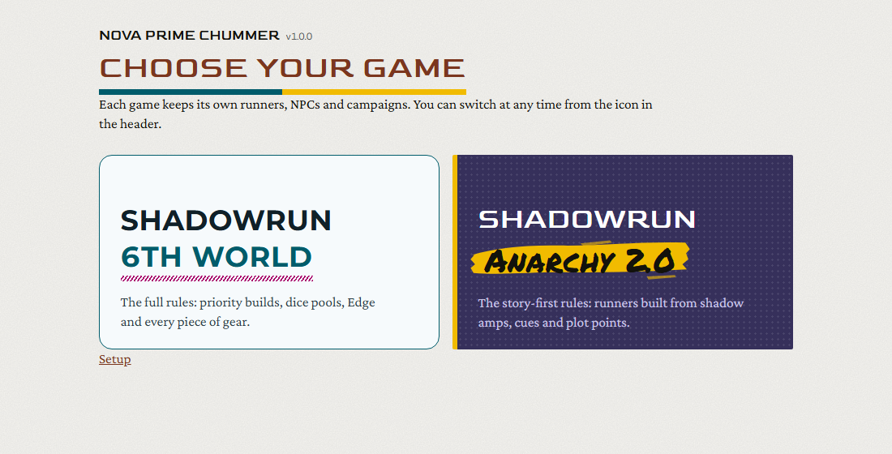

You run it on your own network (a home server, a NAS, a PC) or as a Windows desktop app. Everyone at the table uses it in a browser. It ships the rules engine only: **no book text, tables or art**. You bring your own books. See [How a book becomes data](#how-a-book-becomes-data).

> **About the screenshots.** Every screenshot in this guide uses the dark theme (printed sheets stay paper-colored) and was taken from a real running build with invented sample data (names like "Glimmerkin" and "Zip Spark" are made up). They show how the app looks and works, not what is in any book. `node tools/readme-shots.mjs` retakes them.
## Contents

**Using it**

1. [What it is](#what-it-is)
2. [Key features](#key-features)
3. [The life of a runner](#the-life-of-a-runner)
4. [Shadowrun 6 guide](#shadowrun-6-guide)
5. [Anarchy 2.0 guide](#anarchy-20-guide)
6. [Shared by both games](#shared-by-both-games): [header](#the-header) · [Settings](#settings) · [Setup screen](#the-setup-screen) · [accounts and roles](#accounts-and-roles) · [AI providers](#ai-providers) · [backup](#backup-and-restore) · [backgrounds](#backgrounds-and-art) · [FoundryVTT](#foundryvtt-support)

**Installing it**

7. [Installation](#installation): [choose your install](#choose-your-install) · [Windows installer](#windows-installer) · [Windows portable](#windows-portable) · [Docker](#docker) · [Docker Compose](#docker-compose) · [Unraid](#unraid) · [Pelican or Pterodactyl](#pelican-or-pterodactyl-panel) · [Ubuntu](#ubuntu-systemd-service) · [From source](#from-source)
8. [First run](#first-run)

**Technical**

9. [Technical reference](#technical-reference): [how the pieces fit](#how-the-pieces-fit) · [data folders](#data-folders) · [how a book becomes data](#how-a-book-becomes-data) · [options and environment variables](#options-and-environment-variables) · [development](#development) · [releases](#releases) · [code map](#code-map)
10. [Thanks](#thanks)

## What it is

Build runners with each book's own creation rules. A **Review** tab checks every rule and cites the book and page. If a runner breaks a rule, Review says which one. A GM can approve an exception.

When a runner is finished, you **Finalize** it. From then on a **Ledger** tracks the runner's career:

- **Shadowrun 6** has two currencies, Karma and nuyen. The ledger only grows. A mistake is voided (struck through, with a reason), never silently edited.
- **Anarchy 2.0** has nuyen only. Nothing is locked after Finalize: a change on any tab applies at once, and the ledger logs it with its price (a removed item is refunded).

The two games are kept fully apart. Runners, NPCs, campaigns, books, data, edits, trash and AI settings belong to one game, and the server refuses an object from the other game. Only your account and its role are shared. The first screen asks which game you want, and an icon in the header switches.

## Key features

| | Shadowrun 6 | Anarchy 2.0 |
| --- | --- | --- |
| Creation | Five methods: priority, sum to ten, point buy, karma, lifepath | Level of play, optional package guide, free allocation of nuyen |
| Budget view | Attribute, skill, adjustment, knowledge, contact, power and Karma pools, nuyen, Essence, each itemized | One nuyen receipt that lists every rule |
| Magic and tech | Magic or Resonance tab: spells, rituals, adept powers, metamagics, complex forms, echoes, foci, bound spirits | Shadow Amps (amp builder), Awakened and Emerged amps, spells and complex forms |
| Gear | Weapons, armor, electronics, programs, augmentations, vehicles, drones, critters, starter packs, contacts, SINs, licenses, lifestyles | Weapons, armor, gear, vehicles, spells, lifestyles |
| Designers | Vehicle, drone, weapon and cyberware designers | Amp builder |
| Review | Rule problems block Finalize until fixed or approved by a GM | Same |
| Career | Karma and nuyen ledger with voiding, per-line edit, export and import | Nuyen ledger, changes logged by themselves |
| Sheets | Six printable styles | Four printable styles |
| GM tools | NPCs (grunts, contacts), critters, spirits, sprites | NPCs (regular or prime), critters, spirits |
| Table | Table setup (creation rules, per campaign too), campaigns, compendiums | Table setup (optional and house rules), campaigns, compendiums |
| Data | Import books you own, edit entries, restore a version | Same, plus new entries under a house-rule source, XML overlays and data packs |

Shared by both games:

- **Accounts and roles** (admin, editor, player). The server enforces every rule.
- **Ask the rules**: an AI answers rules questions from your own imported data, with book and page. You choose the provider and bring the key.
- **Backup and restore** of everything as one zip, plus cloud backup to S3 (admin).
- **FoundryVTT export** with a companion module for each game.
- **Trash** for deleted runners and NPCs, **example characters** to load, **portraits**, **background art**.
- **Eight ways to install**: Windows installer, Windows portable, Docker, Docker Compose, Unraid, Pelican or Pterodactyl, Ubuntu, and from source.

## The life of a runner

<p align="center">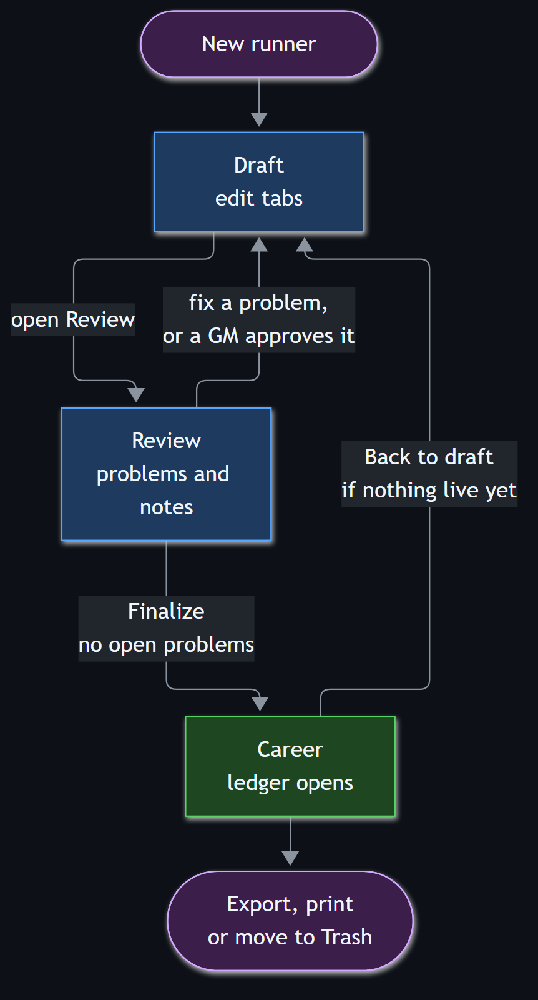</p>

1. **Draft.** You build the runner. Every tab updates the budgets panel at the side.
2. **Review.** Lists every broken rule (a **problem**, which blocks Finalize) and every **note** (which never blocks), each with its book page and a link to the tab that fixes it. A GM can tick **Approved by GM** on a problem.
3. **Finalize.** Locks the creation caps and opens the **Ledger** with a first line, "Creation finished", and what is left over.
4. **Career.** The runner changes by earning and spending. See each game's guide for the details.

## Shadowrun 6 guide

Shadowrun 6 is the Sixth World rule set: the core rulebook and its supplements, as imported from your own PDFs.

### Your runners

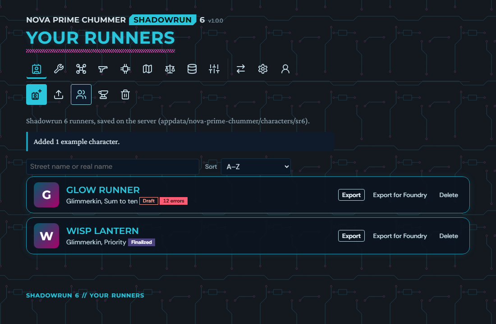

The page lists your SR6 runners with their state (Draft with a count of problems, or Finalized). Icons at the top:

- **New runner**: asks for a street name and a creation method (both can change later).
- **Import file**: a runner file from another server. An Anarchy file is refused with a message.
- **Load example characters**: copies the books' example runners into your list once.
- **Export for Foundry**: tick runners (or a campaign) and download a file for Foundry. See [FoundryVTT support](#foundryvtt-support).
- **Trash**: deleted runners wait here, where you can restore them.

Search by street name or real name, and sort A to Z, Z to A or by recently edited. A runner file the app cannot open is listed with **Download** and **Try to repair**.

### Creating a runner, step by step

1. **New runner.** Type a street name, pick a method, **Create runner**. You land on **Concept**.
2. **Concept.** Names, portrait and token, backdrop, background and notes. The metatype is shown here but chosen on the next tab.
3. **Creation method.** Pick the method and fill in what it asks for. Then the metatype and the magic kind (mundane, magician, adept, mystic adept, aspected, technomancer and so on, as the book allows).

   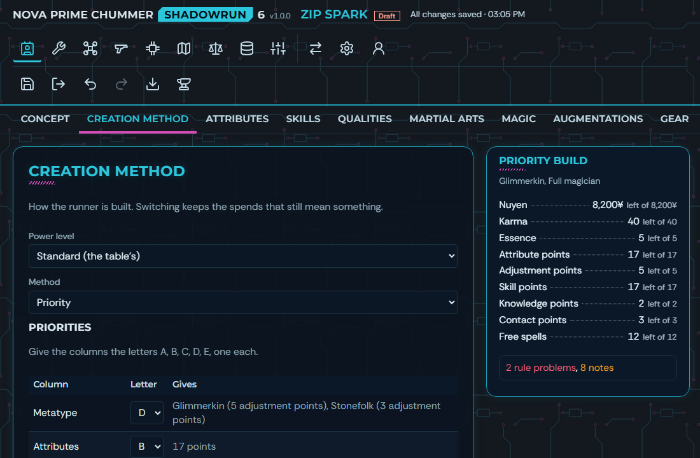

4. **Attributes.** Raise each attribute with points, adjustment points and Karma. The page shows the metatype's range, natural and augmented ratings. Hover an attribute for its card.

   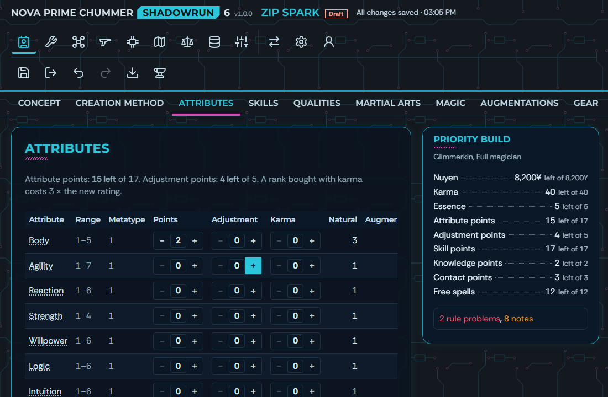

5. **Skills.** Active skills grouped by attribute with points, Karma, dice pool, a specialization and an expertise. Then knowledge skills and languages (one native language per runner).
6. **Qualities.** Positive and negative qualities, with levels where the book has them, and the net Karma against the cap. A quality that names its own choice (an attribute or skill) can be taken again for another choice.
7. **Martial arts.** Styles bought with Karma, each with the techniques learned under it. A style comes with its signature technique.
8. **Magic** (or **Resonance**, for a technomancer). Only shown for an awakened or emerged runner. See [Magic and Resonance](#magic-and-resonance).
9. **Augmentations, Gear, Vehicles, Drones, Critters, Contacts & lifestyle.** See below.
10. **Review**, then **Finalize**.

The **budgets panel** at the side (or a bar you tap, on a phone) shows what is left of each pool. Click a line for its breakdown, each linked to the tab that spends it. Every action can be undone with **Undo** and **Redo** at the top.

### The five creation methods

| Method | How it works |
| --- | --- |
| **Priority** | Give each column (Metatype, Attributes, Magic or Resonance, Skills, Resources) a different letter from A to E. Each letter gives its row's values. |
| **Sum to ten** | Give letters whose values add up to the target. The page shows the running total against the target. |
| **Point buy** | Spend character points on pools (attributes, skills, adjustment, resources, power points, spells, complex forms). Every point has to be spent. |
| **Karma build** | No pools. Everything is bought with the Karma it starts with. |
| **Lifepath** | Pick life modules in order. Each grants things and costs something. It needs a book that prints life modules. |

A method whose settings are not set up yet cannot be picked and says what is missing (set them on **Table setup**). The **Power level** control (Standard, Street or Elite) follows the table's level. Overriding it for one runner asks first and is meant to be done only with your GM's permission.

### Augmentations, gear, vehicles, drones and critters

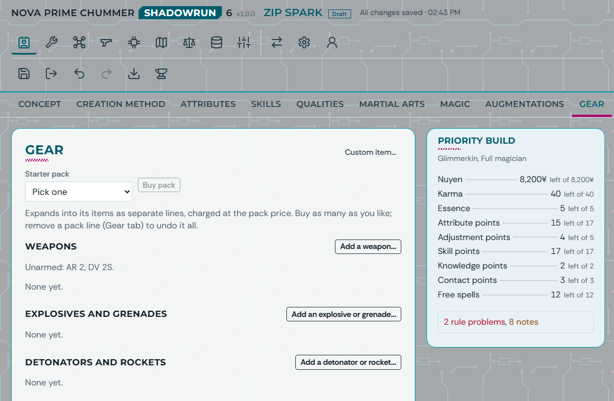

- **Augmentations**: cyberware, bioware, geneware, nanoware, symbionts and transgenics, with rating and grade, Essence cost, and accessories.
- **Gear**: weapons (with accessories and attack ratings), armor, electronics, programs and autosofts, other gear with quantities, and a **Custom item** at your own price. A **Starter pack** picker buys a whole pack as separate lines at the pack's price; removing the pack line undoes it all.
- **Vehicles** and **Drones** (two tabs): each owned one with its stats, what is fitted, and a **Modify** panel for mods, weapon mounts and autosofts. Capacity is enforced when fitting.
- **Critters**: owned critters with their powers, pet class, price, commands and special training, companion qualities and critterware.
- **Contacts & lifestyle**: contacts against the contact points, SINs (real or fake, with a rating) each with licenses and lifestyles, and Karma turned into nuyen.

A weapon or an implant has its own full-page **builder** (open it from its line): factory parts as removable chips, a picker per mount that offers only what fits, and switchable bonuses. You can **Save as design** from there.

### Magic and Resonance

Shown only for an awakened or emerged runner. A magician has a tradition and a drain attribute, a mentor spirit, spells and rituals against the free ones, adept powers (with power points), initiation grade and metamagics, **foci** (buy, Force, bonding Karma) and **bound spirits**. A technomancer's tab is titled **Resonance** and holds complex forms, submersion, echoes and data structures. What the runner's kind cannot learn is shown too, marked, and Review flags it.

### Review and Finalize

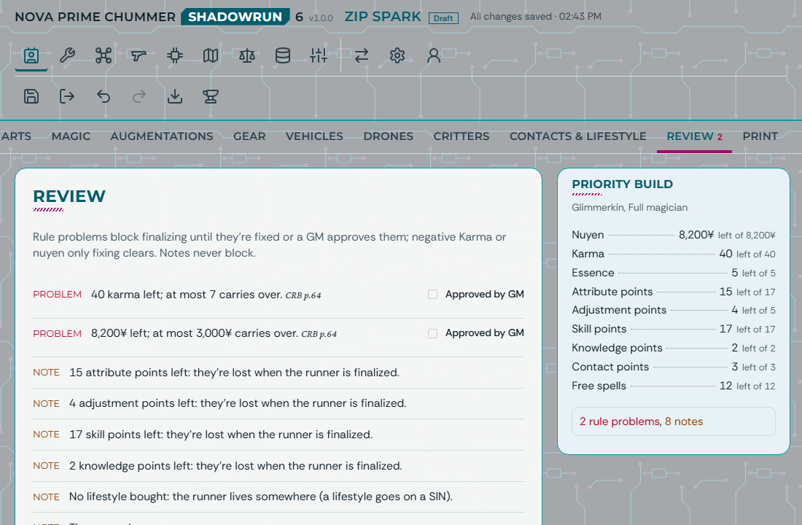

Review lists **problems** and **notes** with their book pages, each linked to where it is fixed. Leftover pool points are notes (they are lost on Finalize). Leftover Karma or nuyen above the carry-over limit is a problem. A GM can tick **Approved by GM**. **Finalize** is at the bottom.

### The career ledger

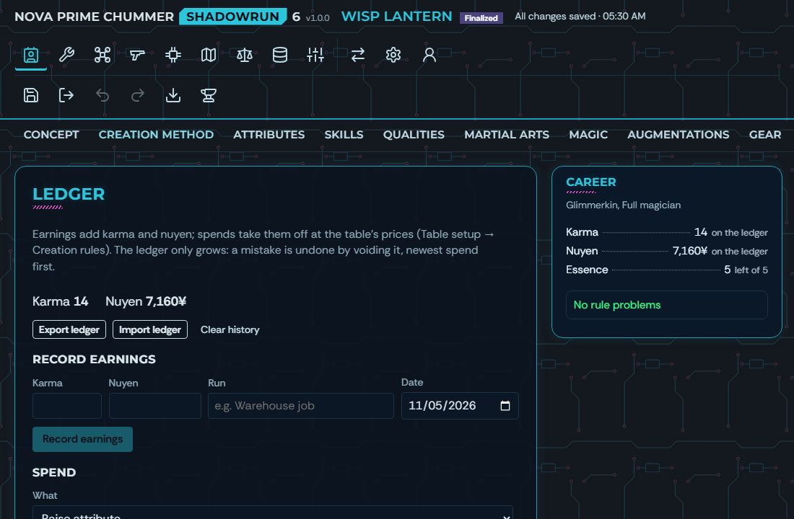

After Finalize, every tab except Concept, Review and Ledger is read only. Changes are made on the **Ledger** tab:

- **Record earnings**: Karma, nuyen, the run's name and a date.
- **Spend**: pick **What**, pick the item, see its price and the balances after, then **Record**. The choices include raising an attribute or skill, a specialization or expertise, knowledge, buying or buying off a quality, learning a spell, ritual, complex form, adept power, martial arts style or technique, power points, initiating or submerging, buying gear, a starter pack, a vehicle, drone or critter, upgrading, selling, fitting or removing accessories and mods, SINs, licenses, lifestyles, contacts, and converting Karma to nuyen and back. Prices come from the table's creation rules.
- **Void** a line (it asks for a reason) and the line is struck through. The newest spend is voided first. **Edit** changes a line. **Add note** writes a note into the history.
- **Export ledger**, **Import ledger**, and **Clear history** (which starts again from the latest finalize).

A spend the runner lacks a prerequisite for is offered too, marked. It is recorded and Review flags it.

**Back to draft** (on Review) is possible only while the ledger holds nothing live to undo.

### Designers

The four designer pages (**Vehicle**, **Drone**, **Weapon**, **Cyberware**) keep designs of your own, saved on the server.

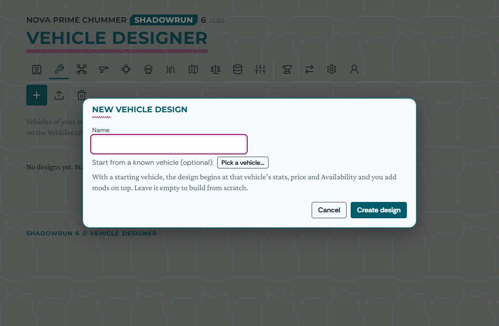

A design can start from scratch or from a known vehicle (it then begins at that vehicle's stats, price and availability and you add mods). A runner buys a design on the **Vehicles** or **Drones** tab (after Finalize, on the Ledger). A GM can mark a player's design approved (only a GM can set that mark). Designs can be exported and imported, and have a trash of their own.

### NPCs and critters (GMs)

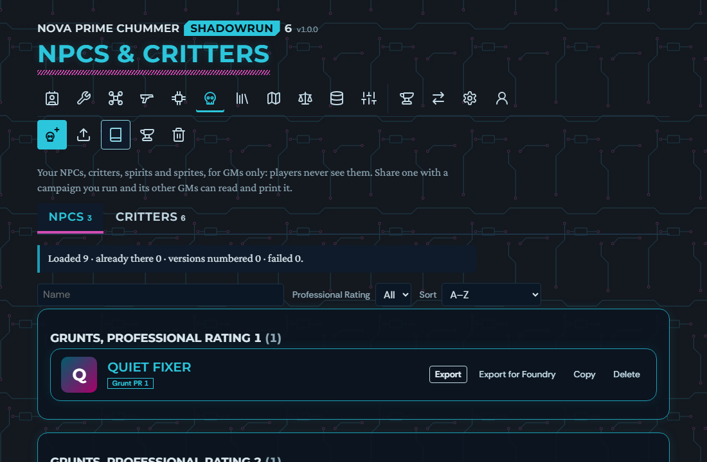

For GMs only: players never see them. Two tabs: **NPCs** (grunts, grouped by Professional Rating, and contacts) and **Critters** (critters, spirits and sprites). **New** makes one, **Load book NPCs** copies the imported books' NPCs once, and **Import** reads a file. Each can be exported, exported for Foundry, **Shared with a campaign** (its other GMs can read and print it), copied or deleted (to the NPC trash). An NPC opens with Concept, Stat block and Print tabs; a critter also has Design.

### Table setup and optional rules

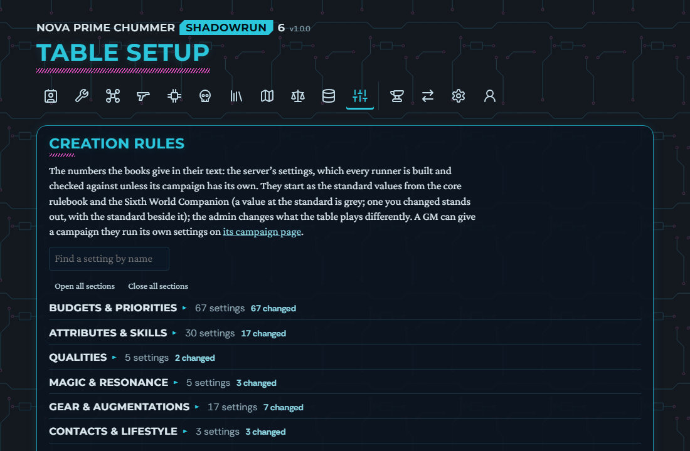

(The "changed" counts in this shot come from the invented sample settings file, not from the standard values.)

Table setup is the page for the whole table. The **Creation rules** are the numbers the books print in their text, each with its page. The admin sets the server's. They start as the standard values (a value at the standard is grey; a changed one stands out with the standard beside it). You can pick a **Rule preset**, **Load settings file** (a `creation.xml` you review before saving), **Reset all to standard**, search for a setting, and reset a section. Options marked as optional or as a house rule are off until a table turns them on.

A GM can give a campaign **its own** settings on its campaign page, and **lock** options so they bind every runner in it. A runner may choose unlocked optional rules itself on its Creation method tab. The standard creation numbers ship as defaults (`public/data/sr6/creation-defaults.xml`).

### Campaigns

A GM (editor or admin) makes a campaign on **Campaigns** and adds players by username. Players add their runners to it from their runner list (**Add to campaign**). The GM reads and prints the campaign's runners; players see the roster. The campaign page has the creation-rules choice (the server's or its own), the locks, the table (GM and players), and GM tools (rename, archive, delete).

### Compendiums

GMs make **compendiums**: their own collections of entries, private or shared with a campaign's GMs or the whole table. A shared entry shows in the pickers as house content.

### Rules, Game data and editing

**Rules** is a searchable reference built from the books you imported, with an AI search above it when AI is set up. **Game data** is the catalog browser: pick a book, search everything, open a section (priorities, metatypes, attributes, skills, qualities, weapons, armor, augmentations and so on), and **Edit** an existing entry. **Needs attention** lists what the importer could not read. **Export to Foundry VTT** is here too.

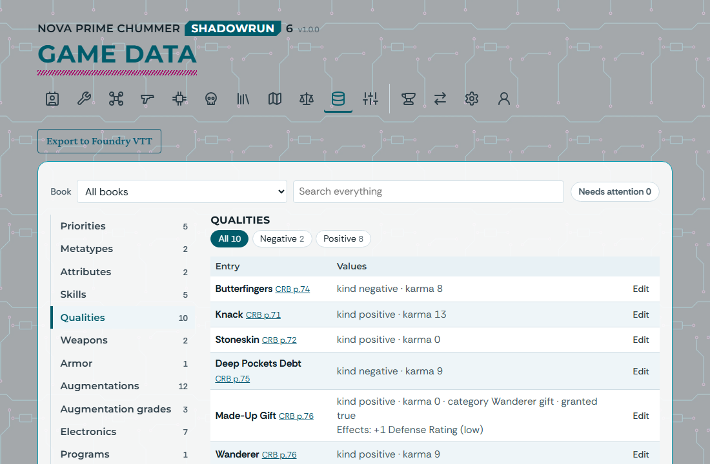 See [How a book becomes data](#how-a-book-becomes-data).

### Sheets

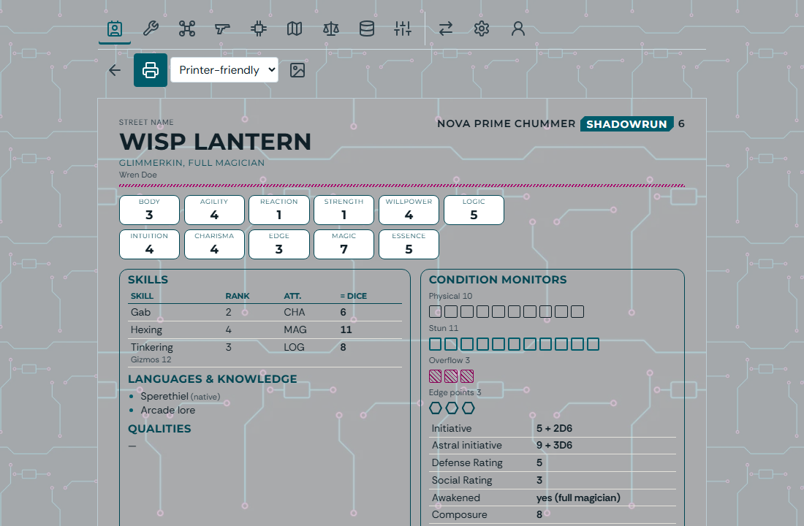

The **Print** tab shows the sheet. Pick a style from the dropdown: **Printer-friendly**, **Full color**, **Book style**, **Neon** (one dense page for play), **Hex** (attributes and tracks as hexagons) or **Dossier** (rounded panels, up to two pages). Use your browser's **Print** and **Save as PDF**. The image icon switches the background art on the sheet.

## Anarchy 2.0 guide

Anarchy 2.0 uses nuyen only. This is the 2.0 rule set, not Anarchy 1st edition.

### Your runners

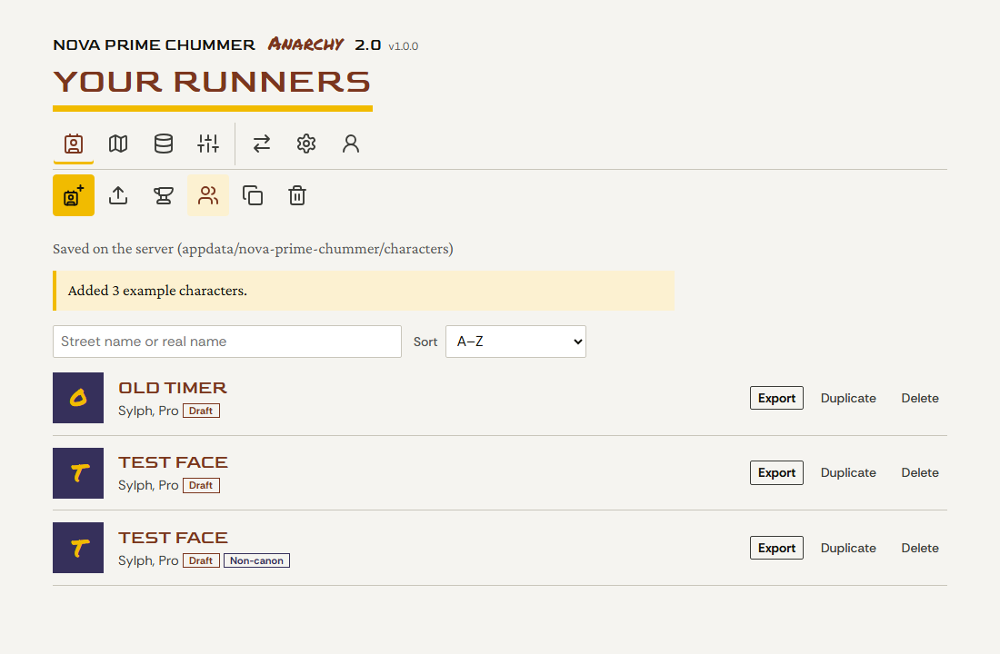

Like Shadowrun 6's list, plus **Duplicate**, a **Find duplicates** icon, and a filter by campaign ("Every runner", "Not in a campaign" or one campaign). **Load example characters** copies the example runners from your imported books once.

### Creating a runner, step by step

1. **New runner.** **Create runner** makes a draft at once and opens **Concept**.
2. **Concept.** Street name, real name, gender, metatype, **Level of play** (Ganger, Runner or Prime Runner in the book; the names and nuyen come from your imported book), an optional **Package guide** (or free allocation), lifestyle, portrait and token, and the book's Keywords, Dispositions and Cues.
3. **Attributes.** Raise each attribute. The page shows the level's caps.
4. **Skills.** Raise skills and add specializations. Knowledge skills and languages are below, in two lists you can reorder, hide or mark native.
5. **Shadow Amps.** Everything special about a runner is a Shadow Amp: Qualities, magic, implants, signature gear, vehicles and contacts. Rating is the amp's base plus its effects, and each point costs nuyen. **Add an amp** opens the book's list, or you build your own.
6. **Gear & spells.** Weapons, armor, gear, vehicles, spells and (for the Emerged) complex forms. Free starting gear is marked.
7. **Review**, then **Finalize**.

The **receipt** at the side (dark panel) lists nuyen per area (attributes, skills and knowledge, Shadow Amps, gear, spells), the creation total and what is left to spend, with Edge, Essence and wound thresholds under it.

### Shadow Amps and the amp builder

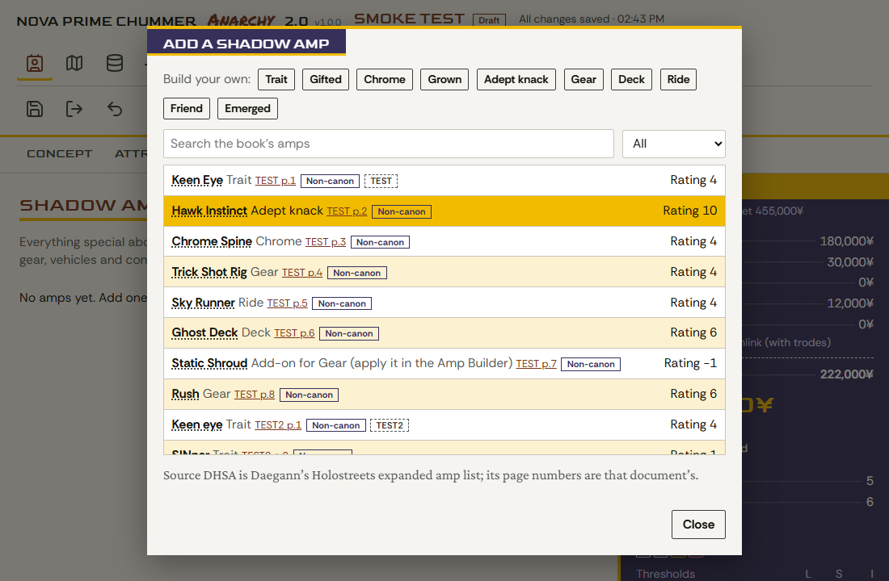

**Build your own** by type: Trait, Gifted, Chrome, Grown, Adept knack, Gear, Deck, Ride, Friend, Emerged. An amp type plus effects gives its rating, cost and Essence. Imported books add prebuilt amps and add-ons (an add-on is applied in the amp builder).

**Technomancers** use the **Emerged** amp, the **Tasking** skill, a living persona and complex forms (from the Conversion Guide). Review flags Tasking or complex forms without the Emerged amp, and an Emerged and Awakened runner together.

### Canon

Material that is not official rules carries a **Non-canon** badge. The GM can switch non-canon content off on Table setup: Review then flags any a runner uses. A runner can also be set to canon only.

### Review and Finalize

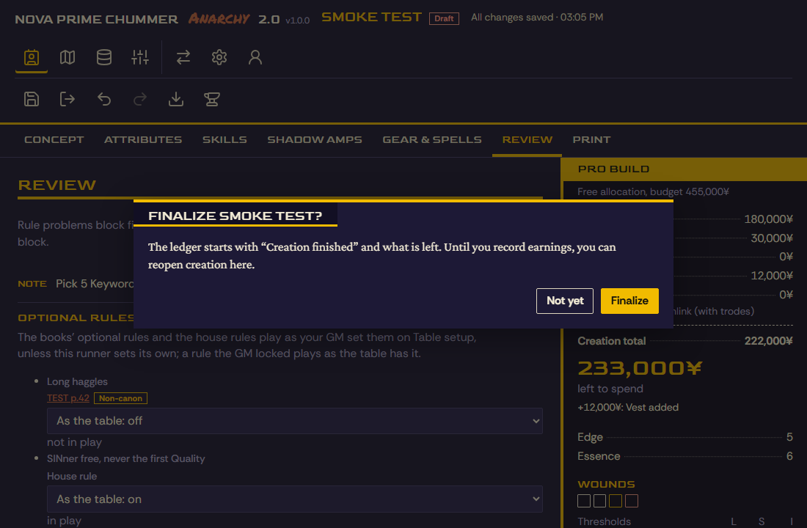

Review lists problems and notes with page numbers. Problems block Finalize until fixed or approved by a GM. In Anarchy, Finalize **locks nothing**: afterwards you can still add, change or remove anything. Adding charges its price, removing refunds the book price, and the level-of-play creation caps stop applying. Until you record earnings, you can reopen creation from Review.

### The nuyen ledger

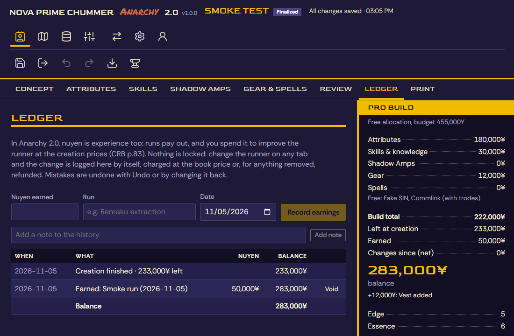

Nuyen is experience too: runs pay out and you spend it to improve the runner. Record earnings with the run's name and a date. A change on any tab is logged by itself at the creation prices, or refunded for anything removed. Mistakes are undone with Undo or by changing the item back. Earnings can be **Voided**. You can add a note to the history.

### NPCs and critters (GMs)

NPCs for GMs: regular or prime NPCs, critters and spirits, with stat blocks. Like SR6's, they are for GMs only and can be shared with a campaign you run. **Load book NPCs** copies them from imported books.

### Table setup and optional rules

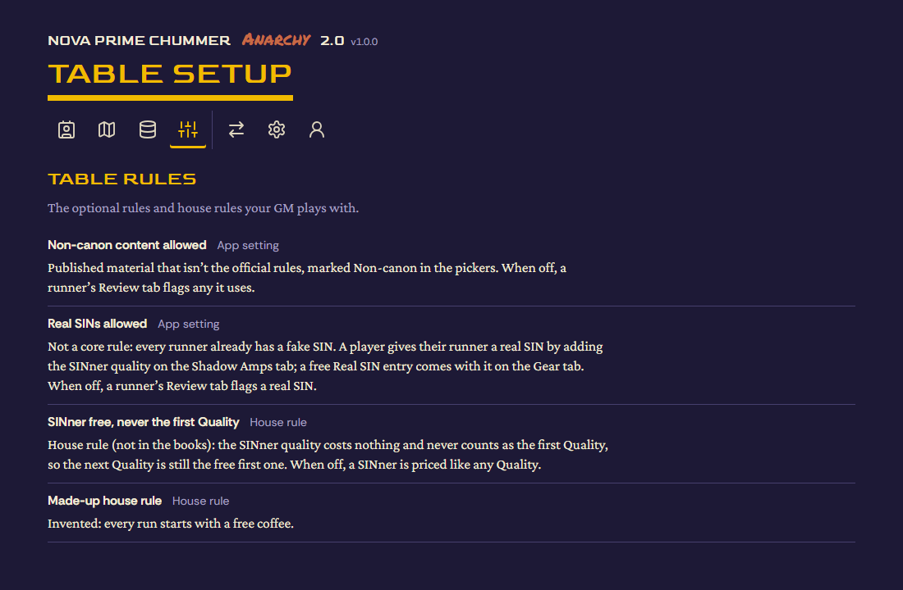

**Table setup** holds the books' optional rules and your house rules. The GM turns them on or off, and can **lock** a rule so it binds every runner (a runner may otherwise set its own). Players see a read-only list. Two **app settings** sit on top: **Non-canon content allowed** and **Real SINs allowed**. Review flags a runner that uses what the table does not allow.

### Campaigns, compendiums, rules, game data

- **Campaigns** work as in Shadowrun 6: a GM, players added by username, runners put in, the GM reads and prints them.
- **Compendiums**: collections of amps, gear, spells, vehicles and NPCs, private or shared. Their entries are house content (Non-canon). The imported books are listed as read-only compendiums.
- **Rules** (GMs): a searchable page built from the quick-reference sheets, with an AI search when set up.
- **Game data**: edit any entry or add new ones under a house-rule source you name. Anarchy also takes custom XML overlays and data packs (see [How a book becomes data](#how-a-book-becomes-data)).

### Sheets

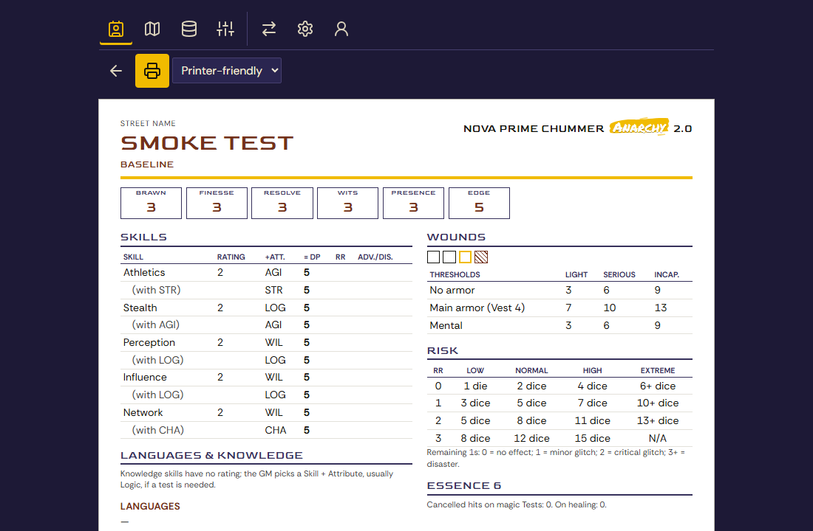

The **Print** tab offers four styles: **Printer-friendly**, **Full color**, **Book style** and **Official sheet** (the two-column fillable layout).

## Shared by both games

These parts work the same in Shadowrun 6 and Anarchy 2.0.

### The header

Every page has a row of icons. Hover one for its name. The set you see depends on your role and the game.

| Icon | Page | Who sees it |
| --- | --- | --- |
| Runner card | **Your runners** | Everyone |
| Wrench, hub, pistol, chip (SR6 only) | **Vehicle designer**, **Drone designer**, **Weapon designer**, **Cyberware designer** | Everyone, on a server |
| Skull | **NPCs & Critters** | GMs (editor, admin) |
| Books | **Compendiums** | GMs, on a server |
| Map | **Campaigns** | Everyone, on a server |
| Open book | **Books** (import) | Admin |
| Scales | **Rules** | Everyone in SR6; GMs in Anarchy |
| Cylinder | **Game data** | Everyone |
| Sliders | **Table setup** | Everyone (players read, GMs set) |
| Anvil | **Export book data for Foundry** | GMs |
| Arrows | Switch to the other game | Everyone |
| Gear | **Settings** | Everyone |
| Person | Your account | Everyone |

When an AI provider is set up for the game, an **Ask the rules** icon appears too, and an AI search shows above Rules and Game data.

### Settings

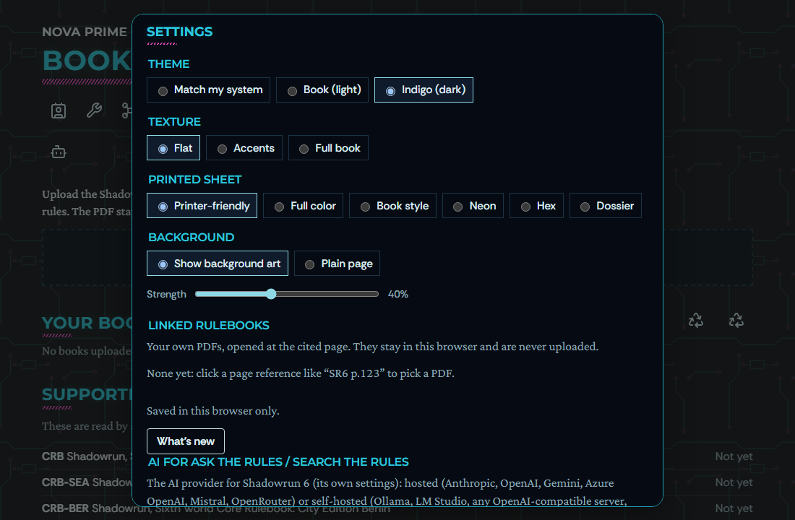

Settings are saved in your browser only: theme (match system, light, dark), texture, the printed sheet style, background art on or off with a strength slider, and **Linked rulebooks** (your own PDFs, opened at the cited page, which never leave your browser). **What's new** shows the newest release notes. Admins also see the AI settings link, background art, sign-in settings and backup here.

### The Setup screen

Admins only. On the game picker, the **Setup** link opens a screen with four tabs: **Configuration** (a few server settings), **Backups** (safety backups, plus cloud backup to S3 when you give it a settings file), **Updates** (desktop app only) and **Game Systems** (each game's version, on or off, and install or update from a zip file or a web address). Installing a game package keeps your runners, NPCs, designs and compendiums.

### Accounts and roles

Every account has one role.

| Role       | Can do                                                                                                                |
| ---------- | --------------------------------------------------------------------------------------------------------------------- |
| **admin**  | Everything: Books, imports, AI settings, Users, sign-in, backup and restore, background art, catalog edits            |
| **editor** | Acts as a GM: runs campaigns, NPCs and compendiums, edits the catalog, sets Table setup and house rules               |
| **player** | Own runners, plays in campaigns, reads Game data and Table setup, Ask the rules                                       |

The server enforces every rule. A hidden button is only convenience. There is always at least one enabled admin.

### AI providers

Set up per game (admin, Books, AI settings). Pick one of:

- Anthropic
- OpenAI, or any OpenAI-compatible server (LiteLLM and the like)
- Ollama or LM Studio (local; a key is optional)
- OpenRouter
- Mistral
- Azure OpenAI
- Google Gemini
- AnythingLLM (with a workspace)

**Load models** lists a provider's models. **Test** checks the saved settings. Keys are stored on the server and never shown again. The admin sets a daily question limit per person on the Users page.

### Backup and restore

**Settings, Backup** downloads everything as one zip: runners, accounts, edits, imported books, PDFs, background art and AI settings. API keys are included only if you tick **Include my API keys**. **Restore** shows what is in the zip first. It saves a safety copy to `Backups` before it replaces anything. The Setup screen's **Backups** tab can also send Config and Data (never your books) to an S3 bucket.

### Backgrounds and art

The admin uploads page backgrounds (PNG, JPEG or WebP) under **Settings, Background art** and switches each on or off. Anyone can fade them or turn them off in their own browser. The character sheet has its own background switches. Each game has its own page background and sheet watermark.

### FoundryVTT support

Export runners, NPCs, compendiums and book data as JSON files, then import them into Foundry with a companion module. Each module refuses the other game's file.

| Game        | Module                                                                                                                   | Foundry system                       |
| ----------- | ------------------------------------------------------------------------------------------------------------------------ | ------------------------------------ |
| SR6         | [Nova Prime Chummer — SR6 Importer](https://github.com/jbowensii/chummer-sr6-foundry)                                    | Shadowrun 6 "Eden" (`shadowrun6-eden`) |
| Anarchy 2.0 | [Nova Prime Chummer — Anarchy 2 Importer](https://github.com/jbowensii/chummer-anarchy2-foundry)                         | Shadowrun Anarchy 2 (`sra2`)         |

**Install a module in Foundry**: Add-on Modules, then **Install Module**. Paste the manifest URL and install.

- SR6: `https://github.com/jbowensii/chummer-sr6-foundry/releases/latest/download/module.json`
- Anarchy 2: `https://github.com/jbowensii/chummer-anarchy2-foundry/releases/latest/download/module.json`

**Export from the app**: use **Export for Foundry** in a runner or NPC editor, **Export for Foundry…** on the runner list or NPCs page (tick the ones you want, or a campaign), or **Export book data for Foundry** on Game data. Book descriptions are included by default. The file is for your own Foundry only, so do not share it.

Formats: [Anarchy export](docs/export-format.md), [SR6 export](docs/sr6-export-format.md).

## Installation

Pick one way to run the app, then follow its steps from top to bottom. Every option below has the same parts: **What you need**, **Install**, **First run**, **Update** and **Uninstall and your data**.

### Choose your install

<p align="center">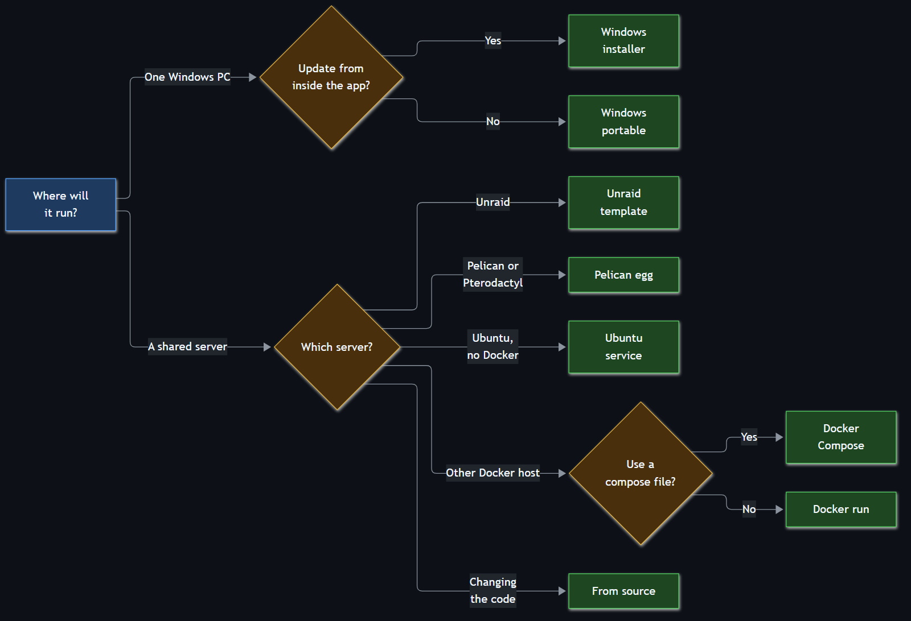</p>

| Method | Best for | Updates | Data lives in | Maturity |
| --- | --- | --- | --- | --- |
| [Windows installer](#windows-installer) | One person, one PC | Check and install from Setup, Updates | `%APPDATA%\nova-prime-chummer` | Main path |
| [Windows portable](#windows-portable) | A USB stick or a PC where you cannot install | Download each new version yourself | `%APPDATA%\nova-prime-chummer` | Main path |
| [Docker](#docker) | A home server | Pull the image, recreate the container | The folder you mount as `/data` | Main path |
| [Unraid](#unraid) | Unraid users | Unraid's Docker tab | `/mnt/user/appdata/nova-prime-chummer` | Main path |
| [Docker Compose](#docker-compose) | Docker hosts that use compose | `docker compose pull` and `up -d` | `./data` next to the compose file | **New in this beta** |
| [Pelican or Pterodactyl](#pelican-or-pterodactyl-panel) | Game-server panels | Restart or reinstall from the panel | `/home/container/data` in the server | **New in this beta** |
| [Ubuntu service](#ubuntu-systemd-service) | A Linux box without Docker | `install.sh update` | `/var/lib/nova-prime-chummer` | **New in this beta** |
| [From source](#from-source) | Developers | `git pull`, rebuild | The folder you set with `DATA_PATH` | For development |

**An honest note on maturity.** Pelican, Docker Compose and Ubuntu are new in this beta. They have automated checks (see [distribution/README.md](distribution/README.md)) but far less field use than Docker, Unraid and the Windows app. If one fails, please [open an issue](https://github.com/jbowensii/nova-prime-chummer/issues) with the log.

### Windows installer

Asset name: `Nova-Prime-Chummer-Setup-1.0.0.exe`, from the [latest release](https://github.com/jbowensii/nova-prime-chummer/releases/latest).

**What you need:** a Windows PC. Nothing else: Python for the importer is bundled.

**Install**

1. Download the `Nova-Prime-Chummer-Setup-1.0.0.exe` asset.
2. Run it. It is a normal wizard (not one-click): you can change the install folder.
3. Release installers are code-signed (a build you make yourself is not). A new certificate can still trigger a Windows SmartScreen warning: check that you downloaded it from the release page, then choose **More info**, then **Run anyway**.
4. Finish the wizard and start **Nova Prime Chummer**. A window opens with the app. There is no browser and no server to start.

The app talks to a server bound to `127.0.0.1` only, so nothing else on your network can reach it. To let other people at the table use it, install it on a shared server instead (see [Choose your install](#choose-your-install)).

**First run:** on the desktop there is **no setup code**: the first screen asks you to create the admin account. Then follow [First run](#first-run).

**Update:** the installed app does not update by itself in the background. Open the **Setup** screen (the **Setup** link on the game picker), then the **Updates** tab, and check for an update. It can make a backup first and then install. You can also download a newer installer and run it over the old one.

**Uninstall and your data:** use Windows **Settings, Apps**. The build does not turn on "delete my data on uninstall", so your data folder is left in place. Your data lives in `%APPDATA%\nova-prime-chummer` (paste that into the File Explorer address bar). It holds `Config`, `Data`, `Library`, `Logs` and `Backups`; the server log is `Logs\server.log`. Delete that folder yourself if you want it gone.

### Windows portable

Asset name: `Nova-Prime-Chummer-Portable-1.0.0.exe`, from the [latest release](https://github.com/jbowensii/nova-prime-chummer/releases/latest).

**What you need:** a Windows PC, or a USB stick. Nothing is installed.

**Install**

1. Download `Nova-Prime-Chummer-Portable-1.0.0.exe`.
2. Put it anywhere (a folder, a USB stick) and double-click it. The same SmartScreen note as in the installer steps applies.

**First run:** no setup code: the first admin is made on screen. Then follow [First run](#first-run).

**Update:** the portable exe **does not update itself**. Download each new version from the release page and run it. It keeps using the same data folder.

**Uninstall and your data:** delete the exe. Your data lives in `%APPDATA%\nova-prime-chummer`, the same place as the installer and not beside the exe. So moving the exe to another PC does not move your runners: copy that data folder across too (or use Settings, Backup and Restore). Delete the folder if you want your data gone.

### Docker

The image is published to GitHub's container registry and is built in GitHub Actions, so there is no build step on your machine.

**What you need:** Docker, and a folder for your data.

**Install**

1. Make a folder for your data, for example `/srv/nova-prime-chummer`.
2. Run:

   ```bash
   docker run -d --init --name nova-prime-chummer -p 8480:80 \
     -v /srv/nova-prime-chummer:/data \
     ghcr.io/jbowensii/nova-prime-chummer:latest
   ```

3. Read the setup code: `docker logs nova-prime-chummer`. Look for the line `No accounts yet. Setup code for the first admin: ...`.
4. Open `http://<the server's address>:8480`.

The container starts as root only to hand `/data` to `PUID`:`PGID` (default 99:100), then runs as that user. Add `-e PUID=1000 -e PGID=1000` to match another host user. Or use `--user` to skip this step; then `/data` must already be writable by that user.

To build the image yourself: `docker build -t nova-prime-chummer:latest .` (add `--build-arg OCR=1` to add OCR for scanned books).

**First run:** Then follow [First run](#first-run).

**Update:** `docker pull ghcr.io/jbowensii/nova-prime-chummer:latest`, then `docker stop nova-prime-chummer && docker rm nova-prime-chummer` and run the same `docker run` command again. Your data stays in the mounted folder. After an update, see "Re-import all books" under [How a book becomes data](#how-a-book-becomes-data).

**Uninstall and your data:** `docker stop nova-prime-chummer && docker rm nova-prime-chummer`, then `docker rmi ghcr.io/jbowensii/nova-prime-chummer:latest`. Your data folder stays until you delete it.

### Docker Compose

New in this beta. File: [distribution/docker/docker-compose.yml](distribution/docker/docker-compose.yml).

**What you need:** Docker with the compose plugin.

**Install**

1. Make a folder, for example `nova-prime-chummer`, and put the compose file in it:

   ```bash
   mkdir nova-prime-chummer && cd nova-prime-chummer
   curl -fsSLO https://raw.githubusercontent.com/jbowensii/nova-prime-chummer/main/distribution/docker/docker-compose.yml
   ```

2. Open the file. Under `environment`, set `PUID` and `PGID` to your user's ids (`id -u` and `id -g` print them). The file ships with `1000`.
3. Start it: `docker compose up -d`.
4. Read the setup code: `docker compose logs nova-prime-chummer`.
5. Open `http://<the server's address>:8480`.

The file maps host port 8480 to the container's port 80 and keeps your data in `./data` next to the file. It restarts the container unless you stop it.

**First run:** Then follow [First run](#first-run).

**Update:** `docker compose pull && docker compose up -d`.

**Uninstall and your data:** `docker compose down`. Your `./data` folder stays until you delete it.

### Unraid

**What you need:** an Unraid server with the Docker tab turned on.

**Install**

1. **Docker** tab, then **Template repositories**. Add `https://github.com/jbowensii/unraid-templates` and **Save**.
2. **Add Container** and pick _nova-prime-chummer_. Check the settings (below), then **Apply**.
3. When it is running, click its icon on the Docker tab, then **Logs**, and read the setup code.
4. Click the icon, then **WebUI** (port **8480**).

The template maps one **Data** folder, `/mnt/user/appdata/nova-prime-chummer`, to `/data`. It sets `PUID` 99 and `PGID` 100, Unraid's `nobody` and `users`. The image is pulled ready-built, so there is no build step on the server. The template's source is [unraid/nova-prime-chummer.xml](unraid/nova-prime-chummer.xml); it is copied into `jbowensii/unraid-templates` at each release.

**Behind a reverse proxy**, fill in **Trusted proxy** (the proxy's address) and **Public address** (the one address people use). See [docs/hosting-auth.md](docs/hosting-auth.md).

**A second instance** (a second table, or a test copy) needs its own name, port and data folder. Add the container from the template again and change three things before **Apply**:

| Setting | First instance | Second instance (example) |
| --- | --- | --- |
| Name | `nova-prime-chummer` | `nova-prime-chummer-2` |
| WebUI Port | `8480` | `8481` |
| Data | `/mnt/user/appdata/nova-prime-chummer` | `/mnt/user/appdata/nova-prime-chummer-2` |

Leave **Data path** (`/data`) alone: that is the path inside the container. The second instance has its own accounts, so it shows its own setup code in its own log.

**First run:** Then follow [First run](#first-run).

**Update:** on the Docker tab, check for updates and apply the one for this container. Your data stays in the appdata folder.

**Uninstall and your data:** remove the container (tick the option to remove its image). The appdata folder stays until you delete it.

### Pelican or Pterodactyl panel

New in this beta. Egg: [distribution/pelican/egg-nova-prime-chummer.json](distribution/pelican/egg-nova-prime-chummer.json).

**What you need:** a Pelican or Pterodactyl panel, admin access to import an egg, and a node that can run Docker images.

**Install**

1. In the panel's admin area, open **Eggs** and import `egg-nova-prime-chummer.json` (download it from the repo first).
2. Create a server from the **Nova Prime Chummer** egg. Give it a port allocation. The panel passes the port to the app as `SERVER_PORT`.
3. Start the server. The egg's installer does nothing (the app is inside the image, which is `ghcr.io/jbowensii/nova-prime-chummer:latest`). The console shows `nova-prime-chummer on` when it is ready.
4. Read the setup code in the panel's console (`No accounts yet. Setup code for the first admin: ...`).
5. Open `http://<the node's address>:<your port>`.

The server runs as the panel's unprivileged user and keeps its data under `/home/container/data` (the egg's **Data folder** variable, which a user cannot edit). The other variable, **Public address**, is for sign-in links: leave it empty if you only use the node's address and port.

**First run:** Then follow [First run](#first-run).

**Update:** restart the server so the panel pulls the current `:latest` image. If the panel does not pull it, reinstall the server from the panel (your files under `/home/container` stay). This path has had little field testing.

**Uninstall and your data:** delete the server in the panel. That removes its files, including your data. Download a backup first (Settings, Backup).

### Ubuntu (systemd service)

New in this beta. Script: [distribution/ubuntu/install.sh](distribution/ubuntu/install.sh). Target: Ubuntu LTS.

**What you need:** an Ubuntu LTS machine, root access, and the code under `/opt`. The script **refuses to run from a home folder** (`/home/...` or `/root/...`), because the service user cannot read a private home folder.

**Install**

1. Get the code somewhere under `/opt`:

   ```bash
   sudo git clone https://github.com/jbowensii/nova-prime-chummer.git /opt/nova-prime-chummer
   ```

2. Run the installer as root:

   ```bash
   sudo /opt/nova-prime-chummer/distribution/ubuntu/install.sh
   ```

   It installs Node 22 (from NodeSource) and Python 3.13 (from the deadsnakes PPA) if they are missing. It makes a system user `novaprime`, a Python virtual environment in `/opt/nova-prime-chummer/.venv`, builds the app, writes the systemd service and starts it. It trusts the NodeSource and deadsnakes install steps as they are.
3. Read the setup code: `sudo journalctl -u nova-prime-chummer | grep "Setup code"`.
4. The service listens on **`127.0.0.1:8480` only**. To reach it from other machines put a reverse proxy in front (see [docs/hosting-auth.md](docs/hosting-auth.md)), or for a quick look from your own PC use an SSH tunnel: `ssh -L 8480:127.0.0.1:8480 you@the-server`, then open `http://localhost:8480`.

To use another port, run the script as `sudo env PORT=9000 /opt/nova-prime-chummer/distribution/ubuntu/install.sh` (for install and for update). Editing the service file by hand does not last: `update` rewrites it. Your data lives in `/var/lib/nova-prime-chummer`.

**First run:** Then follow [First run](#first-run).

**Update:** `sudo /opt/nova-prime-chummer/distribution/ubuntu/install.sh update`. It pulls the repo (if it is a git checkout), refreshes the Python packages, rebuilds, rewrites the service file and restarts.

**Uninstall and your data:** `sudo /opt/nova-prime-chummer/distribution/ubuntu/install.sh uninstall`. It stops and disables the service and renames the unit file to `.removed`. It does **not** delete your data in `/var/lib/nova-prime-chummer`, the `novaprime` user, or the code in `/opt`. Remove those yourself if you want them gone.

### From source

For developers.

**What you need:** Node 22 and Python 3.12 or newer (the importer).

**Install**

1. Get the code and its dependencies:

   ```bash
   git clone https://github.com/jbowensii/nova-prime-chummer.git
   cd nova-prime-chummer
   npm ci
   pip install --require-hashes -r importer/requirements.lock
   ```

2. Build and serve. The server defaults to port 80 and to the data folder `/data`, so set both:

   ```bash
   # bash
   PORT=8480 DATA_PATH=./data npm run serve
   ```

   ```powershell
   # PowerShell
   $env:PORT = 8480; $env:DATA_PATH = "$PWD\data"; npm run serve
   ```

3. The setup code is printed in that terminal. Open `http://localhost:8480`.

The other variables are `PYTHON` (the Python to run the importer) and `STATIC_DIR`. `npm run dev` runs the interface alone on `http://localhost:5173`. It has no server, so no accounts, no Books page and no importer.

**First run:** Then follow [First run](#first-run).

**Update:** `git pull`, `npm ci`, `pip install --require-hashes -r importer/requirements.lock`, `npm run serve`.

**Uninstall and your data:** delete the folder. Your data is in `DATA_PATH`.

## First run

On a server install (Docker, Compose, Unraid, Pelican, Ubuntu, source):

1. Read the one-time **setup code** from the log (the commands are in each install option above). It is new on every restart and works once.
2. Open the app. Choose a game. The first-admin page asks for the setup code, your name, a username and a password (at least 10 characters). That creates the first **admin**.

   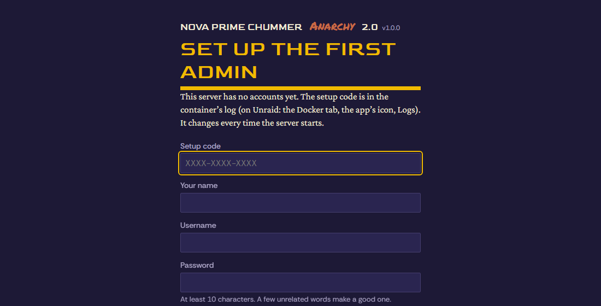

3. Go to **Books** and import your core rulebook (or upload a data pack, Anarchy only). Until you do, the pickers are empty: the app ships no book content.
4. For AI help (Ask the rules, or Anarchy books no recipe knows), set a provider under **Books, AI settings** and type your own key there.
5. Create accounts for everyone else on the **Users** page. There is no self sign-up.

On the Windows desktop app there is no setup code. The first screen asks for the admin account directly.

Locked out? Run `docker exec nova-prime-chummer node server/users.mjs reset <username>` (Compose: `docker compose exec nova-prime-chummer ...`; Ubuntu: from `/opt/nova-prime-chummer` as `sudo -u novaprime env DATA_PATH=/var/lib/nova-prime-chummer node server/users.mjs reset <username>`). It prints a one-time code for `<app address>/#/setup/reset`. The code works once, for 15 minutes.

## Technical reference

Everything from here down is for people running or changing the server. You do not need it to use the app.

### How the pieces fit

<p align="center">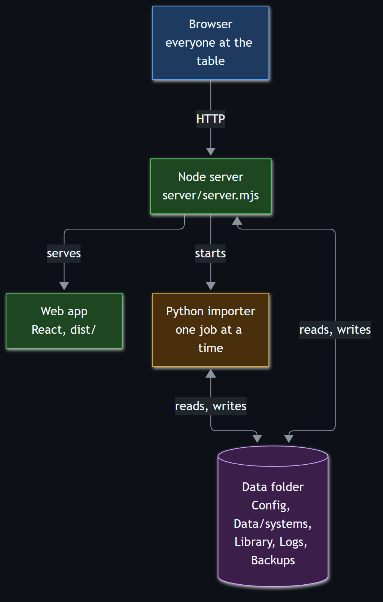</p>

The Node server stores runners as XML files, one folder per account. It never serves the `Library` folder. The Python importer turns a PDF you upload into game data. On Windows desktop the same server runs inside the app, with its own Python bundled.

### Data folders

The container, the panel egg and the desktop app all use this layout:

| Folder | What it holds |
| --- | --- |
| `Config` | Accounts, sign-in settings, AI settings and keys |
| `Data/systems` | Per game: saved runners (a folder per account), house rules, imported books, edits |
| `Library` | Uploaded PDFs, their converted text, import reports. Never served over the web |
| `Logs`, `Backups` | Server logs and the automatic safety copies made before a restore |

An older install with three folders (`characters`, `custom`, `library`) is moved into this layout on the first start. Nothing is deleted. If you still have those three folders, mount their parent folder as the data folder.

### How a book becomes data

The app ships **no book content**: no tables, no rules text, no descriptions. A fresh server shows empty pickers until you load your core data.

<p align="center">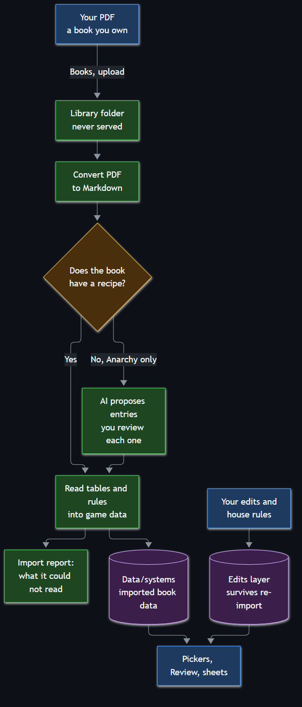</p>

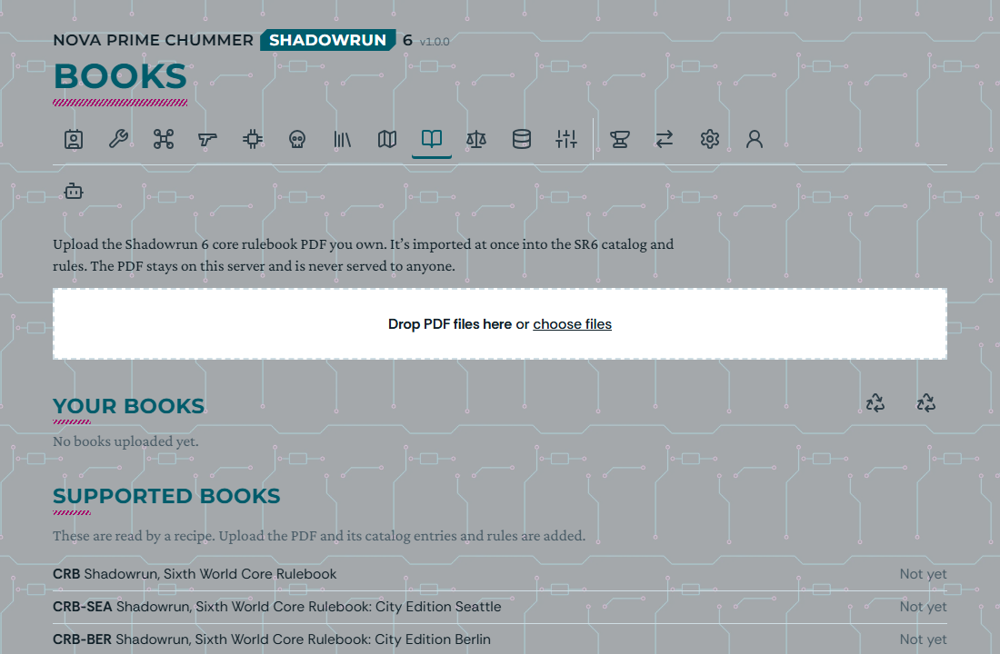

#### 1. Upload books you own

Open **Books** (admin) and drop in the PDF of a book you own. The importer converts the PDF, then reads its tables and rules into game data. A report lists anything it could not read or match. Nothing is guessed.

**Only use books you own.** Your PDFs stay in your `Library` folder and are never served over the web. Nothing is shared or redistributed. Book descriptions stay private to your server.

- Books with a built-in recipe import at once. The Books page lists the supported books under "Supported books". Shadowrun 6 reads only books that have a recipe (its list has dozens of books); Anarchy's recipes cover the core rulebook, the Conversion Guide, the pregens and two community documents.
- **Anarchy only**: any other book can be read by an AI you set up. You review every proposed entry before it is added.
- **Re-import** reruns one book. **Re-import all books** reruns every book (after an app update, say). Your edits, runners and NPCs are kept. In Shadowrun 6, a full **Re-import all books** resets the GM's **creation rules** toggles; re-apply them afterwards.
- Each game has its own AI settings for Ask the rules, including its own AnythingLLM workspace. Put only that game's books in it.
- **Data packs** (Anarchy only): a small zip of the core tables (no descriptions, PDFs or keys). Download one from a server that has the core book. Upload it to set up another server.

#### 2. Enter data yourself

- **Game data** is a catalog editor. **Restore book version** undoes an edit. A re-import never touches your edits.
  - Anarchy: the admin and GMs edit any entry or add new ones under a house-rule source you name.
  - Shadowrun 6: you can change existing entries only. There are no new entries and no house-rule sources.
- **Export my edits** and **Import edits** save your changes as an edits file. Import previews what a file adds, changes and conflicts with.
- **Custom XML overlays** (Anarchy only) in the `custom` folder, listed in `custom/index.xml`, add, replace or remove entries. XSD schemas ship in `public/data/schema/`. Shadowrun 6 has no hand-written overlays. Its schemas are in `public/data/sr6/schema/` and describe the files the importer and the edits write.
- **Table setup** holds your house rules and optional-rule switches.

Formats: [Anarchy data](docs/data-format.md), [SR6 data](docs/sr6-data-format.md).

### Options and environment variables

| Variable | What it does |
| --- | --- |
| `PORT` | The port the server listens on. Default 80 (the Docker image sets it). |
| `SERVER_PORT` | Overrides `PORT` where a panel hands you a port (Pelican, Pterodactyl). |
| `DATA_PATH` | The data folder. Default `/data`. |
| `STATIC_DIR` | The built web app to serve. |
| `PYTHON` | The Python that runs the importer. |
| `PUID`, `PGID` | Docker: the user and group that own `/data` (default 99:100). |
| `TRUST_PROXY` | The reverse proxy's address (Unraid template: _Trusted proxy_). |
| `PUBLIC_URL` | The one address people use (Unraid template: _Public address_). Needed for Authelia sign-in. |

#### Sign-in

- **Local accounts** with an app password. This is the default.
- **Authelia (OpenID Connect)**: admin turns it on under **Settings, Sign-in**. An account is set to sign in with Authelia on the Users page. It needs a public https address (`PUBLIC_URL` or a trusted proxy). Authelia 4.39 or later.
- **Behind a reverse proxy**: set `TRUST_PROXY` (Unraid template: _Trusted proxy_) to the proxy's address. Set `PUBLIC_URL` (_Public address_) to the one address people use. Full setup, including rate-limiting sign-in at the proxy and the Authelia client config: [docs/hosting-auth.md](docs/hosting-auth.md).

### Development

```bash
npm run check          # type check, data validation, unit tests
npm run test:py        # importer tests (Python 3.12)
npm run build && npm run e2e   # Playwright end-to-end tests
npm run lint           # ESLint
npm run format:check   # Prettier (npm run format fixes)
npm run coverage       # test coverage; fails under the floors in vite.config.ts (npm run check runs it)
npm run perf           # timing checks (tests/perf): median of 15 runs per slow path against a budget; not part of npm test
node tools/readme-shots.mjs   # retake the README screenshots (after npm run build)
```

Docs live in [docs/](docs/): data, character and export formats for each game ([Anarchy data](docs/data-format.md), [Anarchy character](docs/character-format.md), [SR6 character](docs/sr6-character-format.md)), the design system ([design-system.md](docs/design-system.md)), and sign-in and hosting ([hosting-auth.md](docs/hosting-auth.md)). The install methods and what checks each: [distribution/README.md](distribution/README.md).

#### Working on one module

The code is split into modules by what they do for the user (`docs/architecture/README.md`). Each module folder has a
short `CLAUDE.md`: what it owns, its public names, what it imports, its test command and what not to touch. Start there,
then read only that module and the public interface of what it imports. The importer and the CommLink6 tools have theirs
in `importer/CLAUDE.md`, `importer/sr6/CLAUDE.md` and `tools/cl6check/CLAUDE.md`.

#### Git hooks (husky)

`npm ci` installs them (the `prepare` script; it does nothing without a `.git` folder, as in CI containers). Commit: Prettier + ESLint on
staged JS/TS, `black --check` on staged `importer/` and `tools/` Python, and the message must be a conventional commit
(`feat(sr6): ...`, `fix: ...`, `chore(ci): ...`; any scope). Push: `tsc -b`, then pylint on the changed Python files. A missing
Python, black or pylint is a warning, not a failure. Emergencies only: `git commit --no-verify` / `git push --no-verify` (CI still checks).

### Releases

A feature PR does not bump the version in `package.json` or edit `CHANGELOG.md`. On GitHub, release-please
(`.github/workflows/release-please.yml`) keeps one release PR open from the conventional commits on `main`; merging it bumps
`package.json`, prepends the section to `CHANGELOG.md`, and creates the tag (`v0.45.0`) and GitHub Release, which starts
`publish.yml`. It needs the repo secret `RELEASE_PLEASE_TOKEN` (a PAT), because a tag made with the default token starts no
workflow. For plain-English notes on top: as the last step before merging, edit `CHANGELOG.md` on the release PR's branch (a later
push to `main` regenerates the PR and drops the edit). The newest section is shown in the app (Settings, "What's new"; once
after each upgrade). Forgejo builds stay untagged. See also `docs/architecture/README.md`, "Release ownership".

Coverage thresholds (`vite.config.ts`) are unchanged for now; raise them a few points at a time once the current batch of work lands.

### Code map

- `server/books.mjs`: the server's route table (its header lists every route) and the map of the modules behind it.
- `src/core/shared/`: code both games use, such as the formula reader (`formula.ts`) and the effect switches (`effects.ts`). Shadowrun 6 imports nothing from Anarchy's engine (`tests/core/shared/import-cycles.test.ts` checks).
- `src/sr6/runner-builder/domain/creation/budgets.ts`: Shadowrun 6 budgets. It re-exports choices, purchases, bonuses, attributes, essence, magic, skills, contacts and karma.
- `src/sr6/table-setup/domain/creation.ts`: the creation settings (Table setup).
- `importer/sr6/catalog.py` and `importer/sr6/recipes/crb.md`: the Shadowrun 6 import.
- `importer/convert.py` and `importer/pdf/`: PDF to Markdown.
- `tools/readme-shots.mjs`: the README screenshots; `electron/README.md`: building the desktop app.

## Thanks

This project stands on the work of others.

- **[Commlink6](https://github.com/taranion/Commlink6)**, the Shadowrun 6 character generator by the RPGFramework / Genesis team.
  - Owner: Stefan Prelle (taranion).
  - Contributors: Kid-Test, mer0mingian, alatarum, MaverickBrandy-AT, Rundohr, janhelke, poolitzerlive4claude, balazsc.
- **[Chummer5a](https://github.com/chummer5a/chummer5a)**, the Shadowrun 5th Edition Chummer application.
  - Owner: chummer5a.
  - Contributors: DelnarErsike, ArchonMegalon, joha4270, JoschiZ, Teksura, holgerschlegel, skarsol, BM123499, HaukeW, HaikenEdge, luizbgomide, and [many more](https://github.com/chummer5a/chummer5a/graphs/contributors).
- **[OMA3](https://github.com/HeyOmae/OMA3)**, a Shadowrun 6 character generator whose ideas shaped parts of this app.
  - Owner: HeyOmae.
  - Contributors: William Johnson (dethstrobe).
- And various others.

Shadowrun is a trademark of its owners (The Topps Company, Inc.; Catalyst Game Labs publishes it under license). Nova Prime Chummer is an unofficial fan tool. It is not affiliated with or endorsed by them. No book content ships with it.